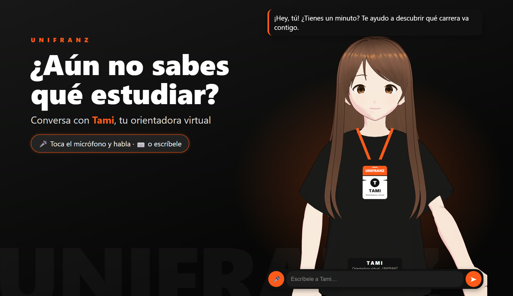
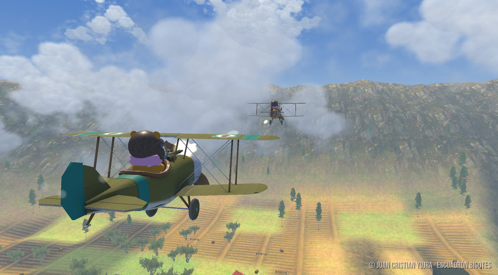

Construyo apps Android y experiencias interactivas.

---

##  Sobre mí

- Estudiante de Ingeniería de Sistemas.
- Me especializo en **apps móviles con Flutter**; también hago web con **Laravel** y **JavaScript**.
- **Visión por computadora:** entreno mis propios modelos (**YOLO**) y uso **MediaPipe** para controlar personajes 3D con el cuerpo y las manos.
- **Videojuegos y 3D:** **Godot** para móvil y **Blender** para modelado, con scripts de Python.
- Me importan la arquitectura feature-first, que las apps funcionen sin internet y las pruebas automatizadas.
- Abierto a colaborar en proyectos.

---

##  Tecnologías

** Móvil**

  

<i>También uso: Riverpod · Drift · GoRouter · ML Kit</i>

** Web y backend**

  

** IA y visión por computadora**

  

<i>También uso: YOLO · MediaPipe · Roboflow · Google Colab</i>

** Juegos y 3D**

  

** Bases de datos**

  

** Herramientas**

  

---

##  GitHub Stats

  <picture>
    <source media="(prefers-color-scheme: dark)" srcset="https://github-readme-stats-fast.vercel.app/api?username=Nobody2077&show_icons=true&theme=tokyonight&bg_color=00000000&hide_border=true">
    
  </picture>
  <picture>
    <source media="(prefers-color-scheme: dark)" srcset="https://github-readme-stats-fast.vercel.app/api/top-langs?username=Nobody2077&layout=compact&theme=tokyonight&bg_color=00000000&hide_border=true">
    
  </picture>

---

##  Proyectos destacados

###  Bitácora RPG Personal

App Android que convierte la organización de mi vida en un **juego de rol** cyberpunk: las tareas son misiones,
completarlas da XP y cada área de la vida (estudios, salud, hogar, proyectos, personal) sube de nivel por separado.
La uso todos los días en mi tablet.

  

- Misiones únicas y recurrentes con recordatorios, cronómetro y un tablón diario.
- Economía personal con libro contable, reservas y una lista de deseos conectada al saldo.
- Diario con estados de ánimo y fotos, enlazado a misiones y movimientos.
- **Privada y sin internet:** SQLite cifrado con clave en el Android Keystore, PIN y biometría.
- Arquitectura *feature-first* con más de 400 pruebas automatizadas.

**Tecnologías:** Flutter · Dart · Riverpod · Drift · Kotlin

---

###  Gesture Puppet

Un personaje 3D que obedece los gestos de mi mano a través de la cámara web, unido a mis dedos con **hilos de marioneta**.
Todo corre en el navegador y ningún cuadro de la cámara sale de la computadora.

  

- ✋ Palma abierta: saluda · ☝ índice: corre hacia donde apunto · ✌ dos dedos: camina · ✊ puño: golpea · 👌 pinza: salta.
- Reconocimiento de gestos con geometría de los 21 puntos de la mano, **sin entrenar ningún modelo**.
- Filtro temporal de 3 cuadros para que el personaje no tiemble con los errores sueltos del rastreo.
- Animaciones de Mixamo mezcladas con `AnimationMixer`, sin el desplazamiento de cadera para que el movimiento lo controle el código.
- Hilos dibujados en un canvas 2D desde cada yema hasta la cabeza, las manos y los pies del personaje.

**Tecnologías:** JavaScript · MediaPipe · three.js · Canvas 2D

---

###  UltramarineGun

Simulador de **bólter** de Warhammer 40K para tablet Android: la tablet se sostiene en horizontal como un arma
y responde a los movimientos reales gracias a sus sensores.

  

- **Disparar** con un tirón de la tablet (acelerómetro) o con el pulgar.
- **Recargar** inclinando la tablet (giroscopio): sale el cargador y se acciona la palanca.
- El arma «habla» con el texto a voz de Android.
- Fogonazo, humo, casquillos y un cañón que se calienta con cada disparo.
- Todo el modelo 3D se genera desde cero con **un solo script de Python** en Blender: malla, texturas PBR horneadas y animaciones.

**Tecnologías:** Blender 4.5 · Python · Godot 4.7 · GDScript · Android

---

###  Toy Detector · YOLO

App Android que reconoce **dos juguetes en tiempo real** con la cámara. Entrené el modelo yo mismo con
**transfer learning**: YOLOv8 preentrenado, ajustado con un dataset propio. Todo corre en el dispositivo, sin internet.

  

- Dataset propio de 162 imágenes etiquetadas en Roboflow.
- Fine-tuning de YOLOv8n en Google Colab (GPU T4): mAP50 0.995 en validación.
- Exportado a LiteRT (TensorFlow Lite) y ejecutado en Flutter a ~10 FPS en tablet.
- Confianza ajustable, linterna, cambio de cámara y carga de modelos nuevos sin recompilar.

**Tecnologías:** Flutter · Dart · YOLOv8 · Python · Roboflow · LiteRT

---

###  Yatiri · La mesa del equilibrio

Mini videojuego web inspirado en la cultura aymara de La Paz y El Alto. Eres un **yatiri** que debe reunir
la **mesa** de ofrenda, leer la **coca** y quemar la **wajt'a** para devolver el equilibrio a la Pachamama.

- Nivel 1: Mercado de las Brujas, recoge ingredientes esquivando a los Anchanchus.
- Nivel 2: La Ceja de El Alto, con enemigos que persiguen y granizo.
- Nivel 3: lectura de la coca, un juego de memoria con símbolos andinos.
- Puntaje y ranking de los 5 mejores guardado en el navegador.
- Proyecto en equipo · funciona sin instalación ni internet.

**Tecnologías:** HTML5 · CSS3 · JavaScript · jQuery

---

##  En desarrollo

###  Tami · Asistente virtual con IA local

Orientadora vocacional con **avatar 3D y voz** que conversa con los postulantes por micrófono o teclado.
Todo corre **en la propia PC, sin internet**: el modelo de lenguaje, la memoria, el reconocimiento de voz y la voz.

  

- LLM local (**Qwen** sobre **llama.cpp** con Vulkan) en una GPU de 8 GB.
- Memoria **RAG** con Chroma: más de 8 000 fragmentos recolectados con **Crawl4AI**.
- Escucha con **Whisper** y habla con **Kokoro**; la boca del avatar se mueve con el volumen de la voz.
- Avatar **VRM** con gestos, fichas de carrera con QR y un **modo expositora** que explica cómo funciona.
- Creado y desarrollado por mí · se presenta en la **Feria Unifranz 2026** (El Alto, 25 de noviembre) junto a Brayan Quispe Mamani.

**Tecnologías:** Electron · three.js · VRM · Python · llama.cpp · Whisper · Kokoro · Chroma

---

###  Escuadrón Bigotes · próximamente en Google Play

Combate aéreo para celulares: un **hámster aviador** pilota su biplano en una guerra entre naciones de hámsters
inspirada en la Primera Guerra Mundial. Juego original: personajes, naciones y emblemas propios.

  

- Modos misión y supervivencia por oleadas, con ases enemigos.
- Ocho aviones en alta definición (cuatro propios y cuatro enemigos) inspirados en cazas reales, con mejoras y fichas históricas.
- Piloto personalizable, clima con tormentas y rayos, y progreso con bellotas y niveles.
- Modelos hechos en Blender con scripts de Python.

**Tecnologías:** Godot 4.7 · GDScript · Blender · Python · Android

---

##  Objetivos actuales

- Publicar mi primera app en Google Play.
- Profundizar en APIs REST: consumirlas desde Flutter y construirlas con Laravel.
- Seguir aplicando pruebas automatizadas y buenas prácticas en cada proyecto.
- Crear soluciones tecnológicas para problemas de mi comunidad.

---

##  Contacto

---

###  Gracias por visitar mi perfil

